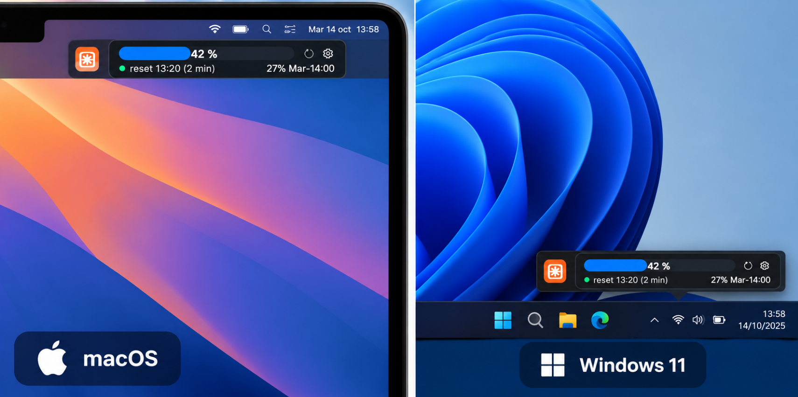
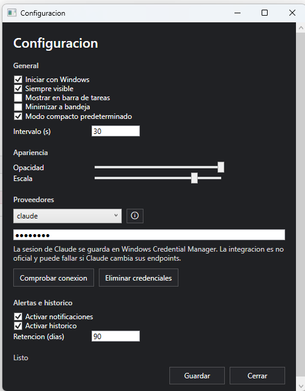

# AI Usage Widget

AI Usage Widget monitors AI provider usage in a compact, floating desktop interface. The Windows application uses WPF; the macOS application uses Avalonia with the same layout, compact/expanded views and shared monitoring logic. Both use C#, .NET 10 and local JSON storage. Credentials are protected by Windows Credential Manager or the macOS login Keychain.

The macOS version includes native WebKit, menu-bar integration, notifications, login startup, and Apple Silicon/Intel packages in DMG and ZIP formats. See the installation instructions below and [macOS build, signing and validation](docs/macos.md) for technical details.

## Screenshots






## Repository Description

```text
Windows and macOS widget for monitoring AI usage limits, with Claude and Demo providers. Built with .NET 10, WPF/Avalonia, local JSON storage and system credential stores.
```

## Features

- Compact floating widget inspired by Windows 11 taskbar widgets.
- Expanded view with provider details and local history.
- Demo provider for running the app without credentials.
- Claude provider isolated behind a non-official integration.
- Local settings and history stored as JSON files.
- Sensitive credentials stored outside JSON using Windows Credential Manager or macOS Keychain.
- System tray icon with quick actions.
- Native macOS menu-bar actions, Dock visibility, login startup and notifications.
- Configurable refresh interval, opacity, scale, notifications and startup behavior.
- No database, no external server, no telemetry.

## Requirements

### Running on Windows

- Windows 10/11.
- .NET Desktop Runtime 10 (x64). The Windows publication and installer do not bundle the runtime.
- WebView2 Runtime for the Claude browser fallback.

### Running on macOS

- macOS 15 or later.
- Apple Silicon (`osx-arm64`) or Intel (`osx-x64`).
- The published Mac application includes the .NET 10 runtime; installing .NET separately is not necessary.

Installation and launch have been confirmed on an Intel iMac running macOS 26.6.2 after removing the download quarantine described below. This confirms launch on that machine; it does not certify every feature or all supported Macs.

### Building from source

- Stable .NET 10 SDK. `global.json` selects an installed stable .NET 10 SDK, with 10.0.100 as the minimum version.
- Windows: Visual Studio 2026 (18.0 or later) with the .NET Desktop Development workload, or the .NET CLI.
- macOS: Xcode Command Line Tools (`xcode-select --install`) to compile the Swift helper and create/sign the application bundle. No .NET macOS or MAUI workload is required.

## Install

### Windows installer

Run `AIUsageWidget-Setup.exe`. When generated locally, the installer is stored at:

```text
artifacts\installer\AIUsageWidget-Setup.exe
```

The IExpress installer installs the app in `%LOCALAPPDATA%\Programs\AIUsageWidget`, creates a Start menu shortcut and starts the application. Install the runtime and WebView2 prerequisites listed above first.

### Download and install the macOS DMG

1. In the GitHub repository, open **Actions → macOS build and tests**.
2. Select a successful run, then scroll down to **Artifacts**.
3. Download the artifact matching the Mac's processor:

| Mac processor | GitHub artifact | DMG inside the downloaded artifact |
| --- | --- | --- |
| Apple Silicon (M1, M2, M3 and later) | `AIUsageWidget-osx-arm64` | `AIUsageWidget-osx-arm64.dmg` |
| Intel | `AIUsageWidget-osx-x64` | `AIUsageWidget-osx-x64.dmg` |

4. Extract the ZIP downloaded by GitHub. Each artifact contains a DMG and a separate application ZIP; open the **DMG** for drag-and-drop installation.
5. Drag **AI Usage Widget.app** onto **Applications**, then eject the mounted DMG.
6. Open **AI Usage Widget** from **Applications**. Install it there before enabling startup at login.

To build packages without a local Mac, push the current source changes and use **Actions → macOS build and tests → Run workflow**. Pushes also trigger this workflow. The macOS runners build and test both architectures, compile the Swift helper, create the packages, and run the application in Demo smoke-test mode. A new run must use the commit containing your changes; re-running an older run uses its original source revision.

### macOS: unblock the first launch

The default build uses an ad-hoc signature and is not notarized by Apple. After downloading it, macOS may show **“The application AI Usage Widget cannot be opened”** or Terminal may report **`operation not permitted`**. A valid bundle signature does not by itself establish Developer ID trust or notarization.

For a build from your own repository or another source you trust, first try **System Settings → Privacy & Security → Open Anyway** after attempting to launch the app. See [Apple's instructions for opening downloaded apps](https://support.apple.com/en-us/102445).

If the app is blocked by download quarantine, open **Terminal on the Mac**. You can first check its signature:

```bash
codesign --verify --deep --strict --verbose=2 "/Applications/AI Usage Widget.app"
```

After a successful check, remove the quarantine attribute from this application and open it:

```bash
xattr -dr com.apple.quarantine "/Applications/AI Usage Widget.app"
open "/Applications/AI Usage Widget.app"
```

These commands resolved the launch block on the tested Intel iMac with macOS 26.6.2. The `xattr` command removes the quarantine attribute only from this application and its contents. If signature verification fails, download a fresh package before applying the workaround.

If it still does not open, run the executable from Terminal and use its output to diagnose the error:

```bash
"/Applications/AI Usage Widget.app/Contents/MacOS/AIUsageWidget.Desktop"
```

Public distribution should use a Developer ID certificate and Apple notarization. The packaging script supports `MACOS_SIGN_IDENTITY` and `MACOS_NOTARY_PROFILE`; see [signing and distribution](docs/macos.md#signing-and-distribution).

## Build and test on Windows

```powershell
dotnet restore AIUsageWidget.sln
dotnet build AIUsageWidget.sln
dotnet test AIUsageWidget.sln
```

## Build and package on macOS

Run these commands on a Mac, from the repository root:

```bash
xcode-select --install
dotnet test AIUsageWidget.Mac.slnf -c Release
bash scripts/Build-Mac.sh osx-arm64
# For Intel:
bash scripts/Build-Mac.sh osx-x64
```

`xcode-select --install` is only needed if the Xcode Command Line Tools are not installed. `AIUsageWidget.Mac.slnf` excludes the Windows WPF application.

For each selected runtime, the script creates:

```text
publish/<runtime>/AI Usage Widget.app
artifacts/macos/AIUsageWidget-<runtime>.zip
artifacts/macos/AIUsageWidget-<runtime>.dmg
```

The script recreates the generated app bundle, publishes a self-contained .NET 10 application, compiles the native Swift helper, generates the icon, signs and verifies the bundle, and creates/verifies the DMG with an Applications shortcut. The bundled runtime is used without relying on a globally installed .NET SDK. `dotnet run` alone does not create the native helper or a complete application bundle.

## Publish on Windows

```powershell
dotnet publish src\AIUsageWidget.App\AIUsageWidget.App.csproj -c Release -r win-x64 --self-contained false -o publish\win-x64
```

The executable will be created at:

```text
publish\win-x64\AIUsageWidget.App.exe
```

## Generate the Windows installer

The project includes two installer paths:

- `scripts\Build-IExpressInstaller.ps1`: builds a basic Windows self-extracting installer using `iexpress.exe`.
- `scripts\Build-Installer.ps1`: builds a conventional desktop installer using `installer\AIUsageWidget.iss`; requires Inno Setup's `ISCC.exe` on `PATH`.

Generate the IExpress installer:

```powershell
.\scripts\Build-IExpressInstaller.ps1
```

Output:

```text
artifacts\installer\AIUsageWidget-Setup.exe
```

The IExpress build stops if publication fails, waits for packaging to finish and replaces the previous installer only after creating the new package successfully.

## Project Structure

- `src/AIUsageWidget.App`: WPF UI, ViewModels, tray icon, windows and application services.
- `src/AIUsageWidget.Desktop`: Avalonia macOS UI, native menu bar, WebKit/notification helper and platform integration. It shares the settings ViewModel and monitor service with Windows.
- `src/AIUsageWidget.Core`: models, interfaces, provider contracts and business rules.
- `src/AIUsageWidget.Infrastructure`: local JSON storage, atomic writes, platform credential stores, logging and login startup.
- `src/AIUsageWidget.Providers`: Demo and Claude provider implementations.
- `tests`: unit tests without real provider accounts.

## Local Data

Runtime data is stored under:

```text
%LOCALAPPDATA%\AIUsageWidget\
```

Typical files:

```text
settings.json
notifications.json
history\
logs\
```

Credentials are not stored in those JSON files. Provider secrets are stored through Windows Credential Manager.

On macOS, data lives in `~/Library/Application Support/AIUsageWidget/` and secrets live in the login Keychain. The `startWithWindows` JSON field is retained for backward compatibility and means “start at login” on macOS.

## Claude Integration

Claude currently does not provide a stable official usage API for this widget. The Claude provider uses isolated, defensive calls to Claude web endpoints and may break if Claude changes its internal API or authentication behavior.

The app never sends Claude credentials to a custom server. The session value is stored locally in Windows Credential Manager or macOS Keychain and is not written to logs.

If Claude returns an unsupported format, blocks the request, or the session expires, the UI reports that the usage data is unavailable or that login is required again.

## Adding a Provider

1. Implement `IUsageProvider` in `AIUsageWidget.Providers`.
2. Return a `UsageSnapshot`; use `null` for unavailable fields.
3. Register the provider in `AIUsageWidget.Providers/DependencyInjection.cs`.
4. Add mapping tests with simulated responses.
5. Do not log tokens, cookies, API keys or full authentication headers.

## Security Notes

- Do not commit `settings.json`, logs, history files, `.env` files, certificates or published binaries.
- Do not commit provider session keys, cookies, tokens or API keys.
- Keep GitHub secret scanning enabled if the repository is public.
- Prefer a private repository until you have reviewed the first commit.

## Known Limitations

- Claude support is non-official and may stop working if Claude changes its web endpoints.
- The widget cannot be shown above elevated administrator windows, UAC prompts, exclusive fullscreen apps, or other aggressively topmost windows in all cases.
- The history chart is intentionally lightweight and does not use a heavy charting dependency.
- Default macOS builds are ad-hoc signed and may require the first-launch quarantine workaround above. Developer ID signing and notarization require separately configured Apple credentials.
